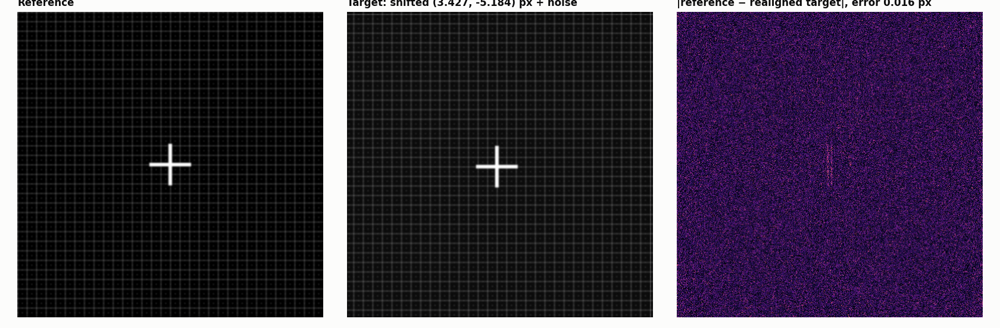
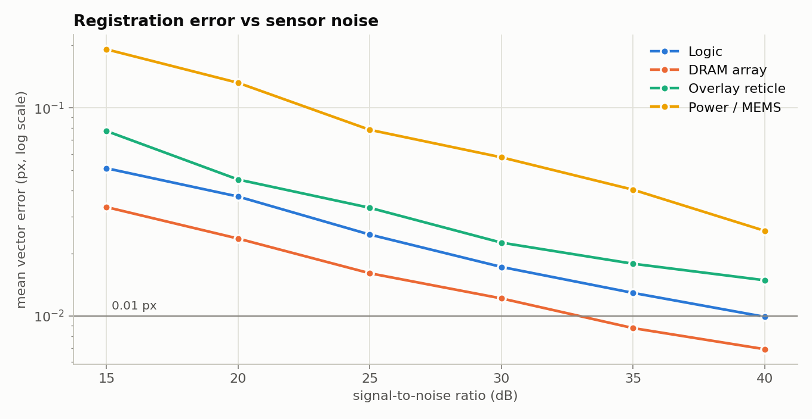
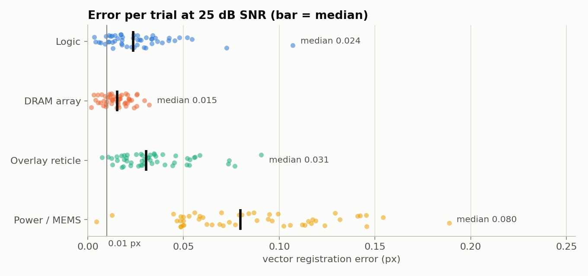
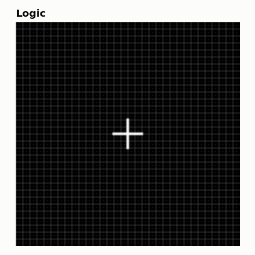
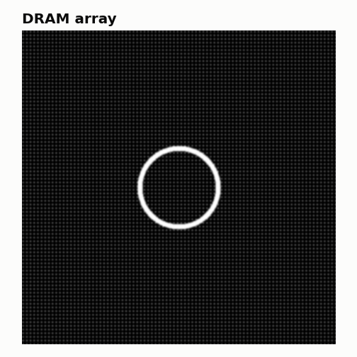
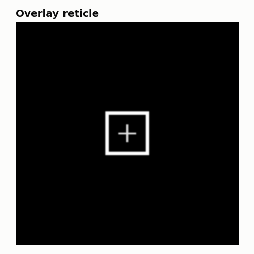
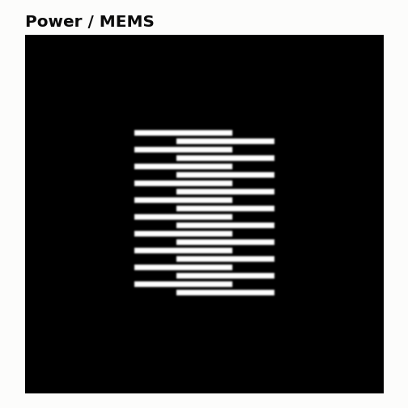

# Sub-Pixel Fourier Wafer Registration


Translation registration to **1/100 pixel** for wafer-inspection and overlay-metrology images, written with NumPy and SciPy only. Phase correlation finds the integer-pixel peak. **Matrix-multiply DFT upsampling** (Guizar-Sicairos et al., 2008) then refines it at 0.01 px spacing, without zero-padding the whole spectrum. The implementation matches scikit-image's reference implementation exactly, and it is benchmarked on four synthetic wafer topologies across 15–40 dB of sensor noise.


<sub>Logic wafer at 30 dB SNR, shifted by (3.427, −5.184) px. The method recovers the shift to 0.016 px. Right: residual after realigning the target.</sub>

## Highlights

| | |
|---|---|
| **Precision** | Upsampling factor κ = 100, so estimates are on a 0.01 px grid |
| **Accuracy at 25 dB SNR** | mean vector error **0.015 px** on a DRAM array and **0.026 px** on a logic layer |
| **Correctness** | Identical to `skimage.registration.phase_cross_correlation` on 50 of 50 random shifts |
| **Speed** | about 24 ms per 512×512 pair on CPU (median) |
| **Dependencies** | NumPy + SciPy for the library; no OpenCV or scikit-image needed |

## How it works

For a reference $f$ and a target $g(x) = f(x - \Delta)$, the normalised cross-power spectrum keeps only phase:

$$R(u,v) = \frac{G(u,v)\,F^*(u,v)}{\lvert G(u,v)\,F^*(u,v)\rvert} = e^{-i2\pi\left(\frac{u\,\Delta_y}{N} + \frac{v\,\Delta_x}{M}\right)}$$

1. **Integer peak.** $\mathcal{F}^{-1}\{R\}$ is a sharp peak at $(\Delta_y, \Delta_x)$; its argmax gives the shift to 1 px.
2. **Matrix-multiply DFT refinement.** Instead of zero-padding $R$ by κ and running a $(\kappa N)^2$ FFT, the inverse DFT is evaluated only on a $1.5\kappa \times 1.5\kappa$ grid centred on the coarse peak, as two matrix products:

$$r_\kappa = K_{\text{row}}\; R \;K_{\text{col}}, \qquad K_{\text{row}}[p,u] = \exp\!\Big(\tfrac{i 2\pi}{N\kappa}\,(p - p_0)\,u\Big)$$

   This costs $O(\kappa N^2)$, against $O(\kappa^2 N^2 \log \kappa N)$ for the zero-padded FFT. The argmax of $\lvert r_\kappa \rvert$ gives the shift to $1/\kappa$ px.
3. **Test shifts without interpolation.** Benchmark targets are shifted exactly in the frequency domain, $G = F\cdot e^{-i2\pi(u\Delta_y/N + v\Delta_x/M)}$. Bilinear or bicubic warping would blur the image and bias the result.

## Results

All numbers come from [subpixel_wafer_registration.ipynb](subpixel_wafer_registration.ipynb) with a fixed random seed. Each value is the mean Euclidean error over 50 random shifts in ±8 px, with Gaussian sensor noise and a Gaussian optical PSF (σ = 1.2 px).

**Accuracy by wafer topology, 25 dB SNR**

| Wafer pattern | Mean error (px) | Std (px) | Median (px) | Max (px) |
|---|---|---|---|---|
| DRAM / memory array | **0.0151** | 0.0069 | 0.0153 | 0.0320 |
| Logic layer | 0.0263 | 0.0185 | 0.0238 | 0.1071 |
| Overlay reticle (box-in-box) | 0.0347 | 0.0185 | 0.0305 | 0.0906 |
| Power device / MEMS | 0.0856 | 0.0385 | 0.0797 | 0.1887 |

**Noise sensitivity: mean error (px) vs SNR**

| SNR | Logic | DRAM array | Overlay reticle | Power / MEMS | All wafers |
|---|---|---|---|---|---|
| 15 dB | 0.0512 | 0.0333 | 0.0774 | 0.1911 | 0.0883 |
| 20 dB | 0.0375 | 0.0235 | 0.0452 | 0.1320 | 0.0595 |
| 25 dB | 0.0246 | 0.0160 | 0.0331 | 0.0784 | 0.0380 |
| 30 dB | 0.0172 | 0.0121 | 0.0225 | 0.0578 | 0.0274 |
| 35 dB | 0.0129 | 0.0087 | 0.0178 | 0.0404 | 0.0200 |
| 40 dB | 0.0099 | **0.0069** | 0.0148 | 0.0256 | 0.0143 |

<p align="center">
  
  
</p>

- **Pattern content matters most.** Fine periodic patterns carry strong high-frequency phase and register best. The wide power/MEMS fingers concentrate their energy at low frequencies and are 3–6× less precise at the same noise level.
- **Sub-0.01 px needs a clean signal.** The DRAM array reaches it from about 35 dB, and the logic layer at 40 dB.

The four synthetic topologies, one image each:

<p align="center">
  
  
  
  
</p>

## Use it in your own project

```python
import numpy as np
from subpixel_registration import register_subpixel_dft, apply_subpixel_shift_fourier

result = register_subpixel_dft(reference, target, upsample_factor=100)
print(result.shift_y, result.shift_x)        # shift of `target` relative to `reference`, in px
print(result.error)                          # 1 - normalised correlation peak: lower = better match

# undo the shift (exact, Fourier domain)
aligned = apply_subpixel_shift_fourier(target, -result.shift_y, -result.shift_x)
```

`reference` and `target` are 2-D grayscale arrays of the same shape, in any dtype; computation is in float64. A larger `upsample_factor` gives a finer grid at roughly linear extra cost.

## Installation & quick start

```bash
git clone https://github.com/<your-username>/subpixel-wafer-metrology.git
cd subpixel-wafer-metrology
python -m venv .venv
source .venv/bin/activate            # Windows: .venv\Scripts\activate
pip install -r requirements.txt
jupyter lab subpixel_wafer_registration.ipynb
```

## Repository layout

```
subpixel_wafer_registration.ipynb   method, cross-check, benchmarks, timing (executed, with results)
src/subpixel_registration.py        library: registration, Fourier shift, noise model, wafer generators
results/figures/                    example registration, error-vs-SNR and per-wafer charts, wafer patterns
results/metrics/                    accuracy_by_wafer_25db.csv, accuracy_vs_snr.csv
requirements.txt
```

## Limitations and next steps

- **Best-case benchmark.** Targets differ from the reference by a pure circular translation, the model the method assumes. Real wafer images add rotation, magnification, focus and illumination changes, and edge effects.
- **Next steps.** Apodisation (Hann window) before the FFT; a log-polar stage for rotation and scale; validation on real optical overlay images; a PyTorch/CUDA port for batched inline inspection.
- **The 0.01 px grid is a floor.** With κ = 100, estimates are quantised to 0.01 px. Increase κ for finer resolution.

## References

- M. Guizar-Sicairos, S. T. Thurman, J. R. Fienup, "Efficient subpixel image registration algorithms," *Optics Letters* 33(2), 156–158 (2008).
- C. D. Kuglin, D. C. Hines, "The phase correlation image alignment method," *Proc. IEEE Conf. Cybernetics and Society* (1975).

## License

MIT, see [LICENSE](LICENSE).
